# Plugin M5Dial

Le plugin **M5Dial** permet d'utiliser des boutons **M5Stack M5Dial** (écran rond, molette, lecteur RFID) comme télécommandes murales pour Jeedom.

Depuis Jeedom, vous pouvez :

- **superviser** chaque bouton (en ligne, version, signal Wi-Fi, mémoire…) ;
- **configurer ses écrans** (lumières, volets, chauffage, présence, capteurs, météo, distributeurs, badges RFID) sans recompiler le firmware ;
- **appairer** un nouveau bouton en quelques secondes, sans mot de passe à saisir ;
- **mettre à jour le firmware** de tous les boutons, depuis Jeedom ou directement depuis GitHub ;
- **afficher et piloter vos plannings** (facultatif) : planning du thermostat avec le plugin [planningThermo](https://github.com/JeromeR60/jeedom-planningThermo) (§5.4) et planning des distributeurs avec le plugin [planningDistrib](https://github.com/JeromeR60/jeedom-planningDistributeur) (§5.3). Ces deux plugins s'installent séparément ; sans eux, les écrans Chauffage et Distributeur fonctionnent normalement.

Toute la communication passe par **MQTT**.

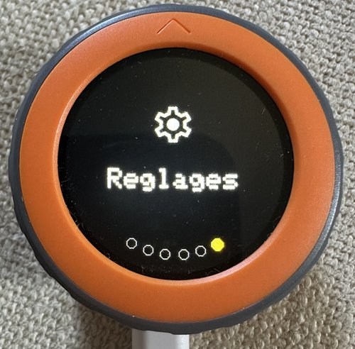

---

## 1. Prérequis

| Élément | Détail |
| --- | --- |
| Jeedom | 4.4 ou plus, Debian 11 ou plus |
| Plugin **MQTT Manager** (mqtt2) | installé, configuré et **démarré** : il fournit le broker et la connexion |
| Utilisateur MQTT | au moins un utilisateur déclaré dans MQTT Manager (champ *Authentification*, format `utilisateur:motdepasse`) |
| Bouton M5Dial | M5Stack Dial v1.1 avec le firmware M5Dial (dernière version conseillée, installée depuis la page d'installation web, §3.1) |
| Wi-Fi | réseau **2,4 GHz**. Sur les bornes Wi-Fi 6 (802.11ax), activez si possible le mode de compatibilité Wi-Fi 5 sur la radio 2,4 GHz : en Wi-Fi 6 pur, le bouton peut perdre beaucoup de paquets (commandes lentes, déconnexions MQTT) |

> Conseil : réservez une adresse IP fixe (bail DHCP) pour chaque bouton sur votre box ou routeur.

**Configuration de MQTT Manager** (Plugins → Programmation → MQTT Manager) : le mode **Broker local** convient, l'état du broker doit être **OK** et le démon démarré. Dans **Authentification**, ajoutez une ligne pour les boutons, par exemple `m5dial:unMotDePasseSolide` (une ligne par utilisateur, format `utilisateur:motdepasse`), puis **Sauvegardez**. Ce mot de passe est transmis automatiquement aux boutons lors de l'appairage : vous n'avez jamais à le saisir sur le bouton.

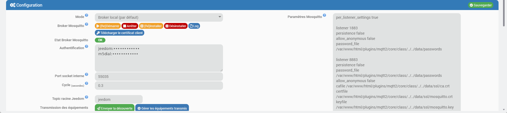

---

## 2. Installation et configuration du plugin

Le plugin s'installe depuis GitHub (il n'est pas encore sur le Market Jeedom).

1. **Autorisez GitHub comme source** (une seule fois) : **Réglages → Système → Configuration** → onglet **Mises à jour/Market** → sous-onglet **GitHub** : cochez **Activer GitHub**, puis **Sauvegarder**. Le jeton (token) n'est pas nécessaire.
2. **Ajoutez le plugin** : **Plugins → Gestion des plugins** → bouton **+** (Ajouter un plugin) → type de source **GitHub** :

   | Champ | Valeur |
   | --- | --- |
   | ID logique du plugin | `m5dial` |
   | Utilisateur ou organisation du dépôt | `JeromeR60` |
   | Nom du dépôt | `jeedom-m5dial` |
   | Branche | `main` |

   **Enregistrez**, puis **activez** le plugin.
3. Les nouvelles versions arrivent par la mise à jour habituelle des plugins (**Réglages → Système → Centre de mise à jour**). Pour une installation depuis GitHub, Jeedom affiche un numéro de commit au lieu de la version : la version du plugin est indiquée dans sa configuration.

> La branche `beta` reçoit les nouveautés en avant-première (voir le [guide du bêta-testeur](beta-testeurs.md)). Pour un usage normal, restez sur `main`.

4. Ouvrez **Plugins → Gestion des plugins → M5Dial → Configuration**.

### Section « Général »

- **Version du plugin** : version installée (Jeedom n'affiche qu'un numéro de commit pour une installation depuis GitHub).
- **Topic racine des boutons** : `m5dial`. Les boutons publient sur `m5dial/<nom>/status` et `m5dial/<nom>/info` et reçoivent leur configuration sur `m5dial/<nom>/config`.
- Le plugin s'abonne automatiquement à ce topic auprès de MQTT Manager.

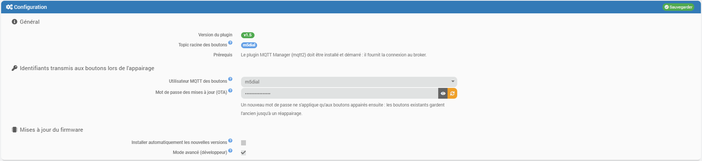

### Section « Identifiants transmis aux boutons lors de l'appairage »

- **Utilisateur MQTT des boutons** : choisissez un utilisateur de MQTT Manager. Son mot de passe est transmis automatiquement au bouton lors de l'appairage : vous n'avez jamais à le saisir.
- **Mot de passe des mises à jour (OTA)** : généré par le plugin à l'installation. L'icône en forme d'œil l'affiche. **Générer un nouveau mot de passe** en crée un autre, qui ne s'applique qu'aux boutons appairés **ensuite** (les autres gardent l'ancien jusqu'à un réappairage).

> Le mot de passe OTA ne sert qu'aux mises à jour depuis PlatformIO (développement). Les mises à jour depuis Jeedom n'en ont pas besoin.

### Section « Mises à jour du firmware »

- **Installer automatiquement les nouvelles versions** (décoché par défaut) : chaque nuit, le plugin vérifie la dernière version publiée. Il vous prévient toujours ; si la case est cochée, il installe aussi la nouvelle version sur les boutons en ligne.
- **Mode avancé (développeur)** : affiche le bouton « Déposer un firmware.bin » pour installer un firmware compilé soi-même.

### Section « Fonctionnalités »

La vérification des nouvelles versions est lancée chaque nuit par la tâche **cronDaily**. Vérifiez qu'elle est sur **Oui** et que la case **Activer** est cochée.

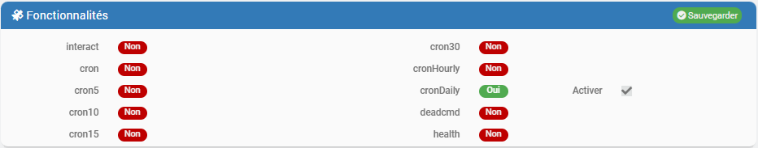

---

## 3. Premier démarrage d'un bouton

### 3.1 Installer le firmware (bouton neuf)

L'installation se fait **depuis le navigateur**, sans logiciel à installer.

1. Sur un ordinateur, ouvrez **Chrome** ou **Edge** à l'adresse **https://jeromer60.github.io/jeedom-m5dial/installer/** et branchez le M5Dial avec un câble **USB-C de données**.

   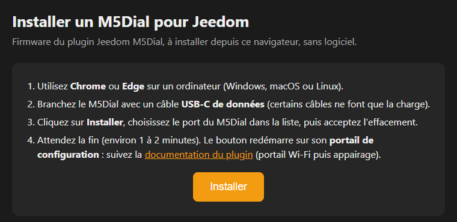

2. Cliquez sur **Installer**, choisissez le port du M5Dial dans la liste du navigateur (souvent « USB JTAG/serial debug unit »), puis **Install M5Dial pour Jeedom**.

   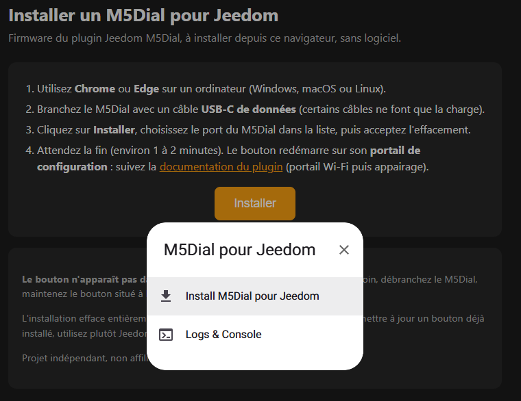

3. Laissez cochée la case **Erase device** (effacement complet, conseillé pour un bouton neuf), puis **Next**.

   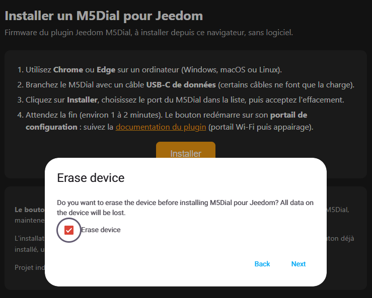

4. Confirmez avec **Install**.

   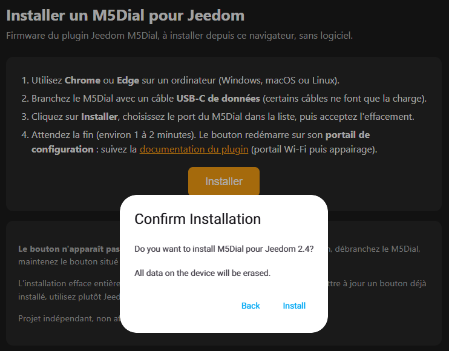

5. Patientez 1 à 2 minutes en gardant la page visible.

   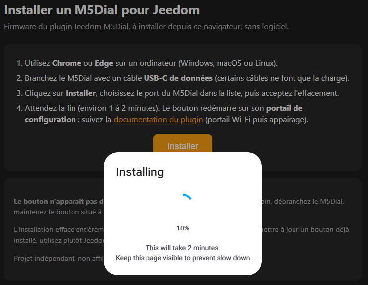

À la fin, le bouton redémarre sur son **portail de configuration** (§3.2). S'il ne redémarre pas, débranchez-le puis rebranchez-le. Les mises à jour suivantes se font depuis Jeedom (voir §6).

> Si le M5Dial n'apparaît pas dans la liste : essayez un autre câble, ou débranchez-le, maintenez le bouton situé à l'arrière, rebranchez-le puis relâchez.

### 3.2 Portail de configuration Wi-Fi

Au premier démarrage (aucun Wi-Fi enregistré), le bouton ouvre son **portail de configuration** :

1. L'écran affiche le nom d'un réseau Wi-Fi (`M5Dial-XXXX`), un mot de passe à 8 chiffres et un **QR code**.
2. Connectez votre téléphone ou ordinateur à ce réseau (en scannant le QR code ou manuellement).
3. Ouvrez **http://192.168.4.1** dans le navigateur.
4. Choisissez votre Wi-Fi dans la liste, saisissez son mot de passe et l'**adresse de Jeedom** (IP du broker MQTT), puis validez.

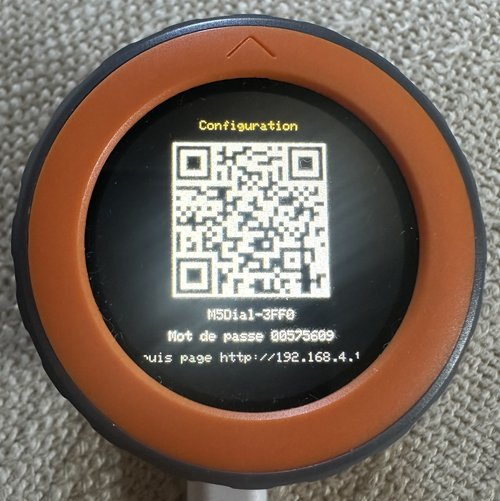 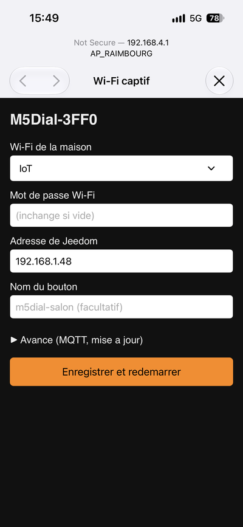

Le bouton redémarre et se connecte à votre réseau.

Le portail se rouvre aussi :

- si le Wi-Fi enregistré reste injoignable pendant 90 secondes ;
- si vous **maintenez le bouton appuyé au démarrage**, pour changer de Wi-Fi ou forcer un réappairage (section *Avancé*, case *Réappairer*).

> Sur iPhone, la page s'ouvre automatiquement dans la fenêtre « Wi-Fi captif ». En cas d'échec, « oubliez » le réseau `M5Dial-XXXX` dans les réglages Wi-Fi puis réessayez.

### 3.3 Appairage avec Jeedom

Si le bouton ne connaît pas encore ses identifiants MQTT, il passe en **appairage** :

1. L'écran du bouton affiche un **code à 4 chiffres**.
2. Dans Jeedom, ouvrez la page du plugin M5Dial : la demande apparaît dans **Nouveaux boutons en attente d'appairage** (nom, adresse MAC, adresse IP, firmware, code).
3. **Vérifiez que le code est identique** à celui affiché sur le bouton, puis cliquez sur **Accepter** (ou **Refuser**).
4. Le bouton reçoit l'utilisateur et le mot de passe MQTT ainsi que le mot de passe OTA, les enregistre dans sa mémoire et redémarre.

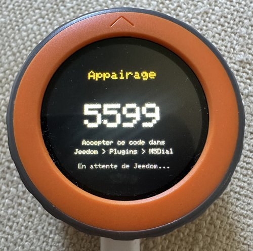

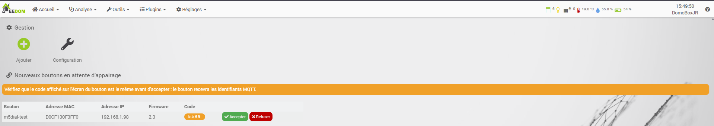

Quelques secondes plus tard, l'équipement est **créé automatiquement** dans Jeedom.

> Un bouton déjà connu de Jeedom (même adresse MAC), par exemple après une réinitialisation, est **reconnu automatiquement** : il retrouve son équipement, ses commandes et sa configuration, même s'il revient sous un autre nom.

---

## 4. Les équipements

Chaque bouton apparaît dans **Mes boutons M5Dial** dès qu'il se connecte au broker. La vignette indique :

- l'**état** : En ligne (pastille verte), Hors ligne ou Jamais vu ;
- la **version du firmware** ;
- la **source de la configuration** (envoyée par Jeedom ou locale au bouton).

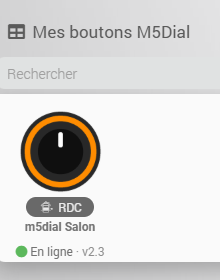

### Onglet « Equipement »

- Paramètres Jeedom habituels : nom, objet parent, catégorie, activer, visible.
- **Nom du bouton** : nom MQTT du bouton (ex. `m5dial-salon`), rempli automatiquement.
- **Identifiant MQTT** : nom suivi des 4 derniers caractères de l'adresse MAC (unique par bouton).
- **Mettre à jour le firmware** : voir §6.

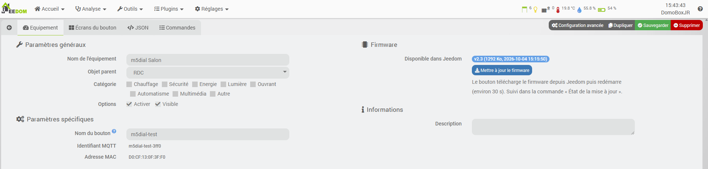

### Commandes

| Commande | Type | Rôle |
| --- | --- | --- |
| En ligne | info binaire | 1 si le bouton est connecté (message de « dernière volonté » MQTT) |
| Version firmware | info texte | version installée sur le bouton |
| Adresse IP | info texte | adresse du bouton sur le réseau |
| Signal Wi-Fi | info numérique (dBm) | qualité du Wi-Fi (bonne au-dessus de −65 dBm) |
| Source de la configuration | info texte | Jeedom ou locale |
| Durée de fonctionnement | info numérique (min) | temps depuis le dernier redémarrage (historisée sur les nouveaux équipements : repart à 0 à chaque redémarrage) |
| Mémoire libre | info numérique (Ko) | mémoire disponible sur le bouton au moment de l'envoi, toutes les 5 min (historisée) |
| Mémoire mini | info numérique (Ko) | point le plus bas atteint depuis le démarrage (historisée, firmware 2.9) |
| Plus gros bloc libre | info numérique (Ko) | plus grand bloc réservable d'un coup ; s'il baisse alors que la mémoire libre reste stable, la mémoire se fragmente (historisée, firmware 2.9) |
| Dernière erreur de configuration | info texte | erreur renvoyée si la configuration reçue est invalide |
| État de la mise à jour | info texte | avancement d'une mise à jour du firmware |
| Envoyer la configuration | action | envoie la configuration de l'équipement au bouton |
| Revenir à la configuration locale | action | efface la configuration envoyée : le bouton reprend son `config.json` interne |
| Mettre à jour le firmware | action | récupère si besoin la dernière version publiée sur GitHub, puis lance la mise à jour du bouton |
| Mise à jour disponible | info binaire | 1 si une version plus récente du firmware est publiée (utilisable dans un scénario) |

Les informations sont rafraîchies toutes les 5 minutes et à chaque reconnexion du bouton.

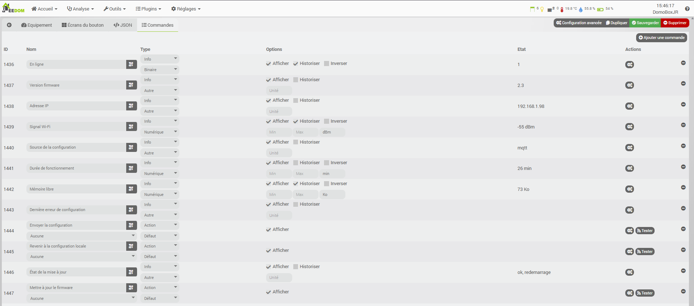

---

## 5. Configurer les écrans d'un bouton

### Onglet « Écrans du bouton »

Cochez les écrans à afficher sur le bouton, puis choisissez les commandes Jeedom avec le sélecteur de commandes.

**Ordre du menu** : le cadre **Menu du bouton**, en haut de l'onglet, liste les écrans cochés. Les flèches ▲▼ changent leur ordre sur le bouton ; le premier est affiché au démarrage. **Réglages** reste toujours en dernier. (Firmware 2.6 ou plus.)

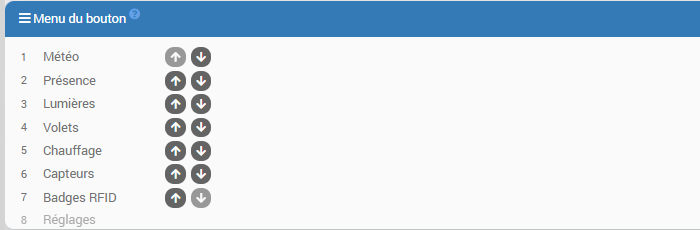

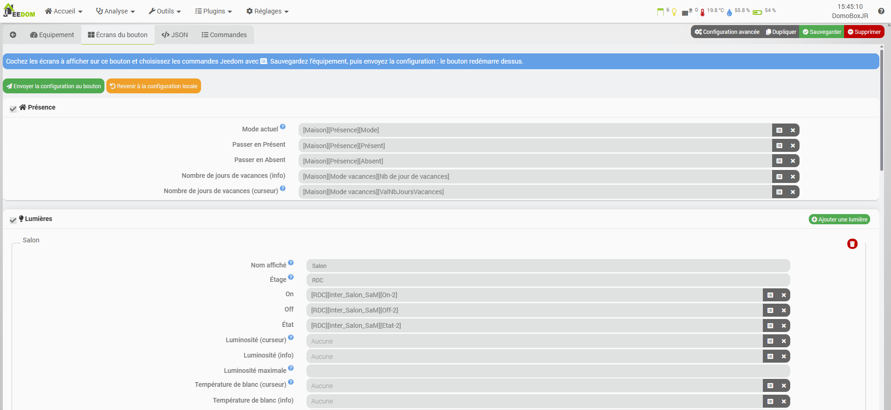

| Écran | Ce qu'on configure |
| --- | --- |
| **Présence** | mode actuel (Présent / Absent / Vacances), actions Présent et Absent, nombre de jours de vacances (info + curseur) |
| **Lumières** | une ligne par lumière : nom affiché, étage, On / Off / État et, en option, luminosité, température de blanc (mireds) et couleur |
| **Volets** | une ligne par volet : nom, étage, position (info et curseur), Monter / Descendre / Stop |
| **Actions groupées** | tout allumer / éteindre, ouvrir / fermer tous les volets ou par étage, heure de fermeture automatique |
| **Chauffage** | température ambiante, consigne (info, curseur, mini, maxi, pas), modes Confort / Eco / Nuit / Vacances / Off (seuls les modes renseignés apparaissent sur le bouton ; Eco nécessite le firmware 3.0), statut de chauffe, puissance, température extérieure. Le bouton **Importer depuis un thermostat** remplit la section à partir d'un équipement du plugin Thermostat. Champ **Planning** (facultatif) : équipement du plugin planningThermo, affiché sur une page supplémentaire de l'écran Chauffage (voir §5.4) |
| **Capteurs** | une ligne par pièce : nom, température, humidité |
| **Météo** | température, et en option humidité, icône de la condition, min / max, lever et coucher du soleil (voir §5.2) |
| **Distributeurs** | une ligne par distributeur (croquettes…) : nom, planning planningDistrib (facultatif), commande curseur qui distribue, doses mini / maxi, état de connexion (voir §5.3) |
| **Badges RFID** | commande message appelée quand un badge est passé, commande pour enregistrer un nouveau badge, et info qui renvoie le résultat à afficher (voir l'exemple complet au §5.1) |

> Écrivez les noms affichés **sans accents** : la police du bouton ne les contient pas.

Ensuite :

1. **Sauvegardez** l'équipement.
2. Cliquez sur **Envoyer la configuration au bouton** : le bouton l'applique et redémarre sur ses nouveaux écrans.

Pour annuler, **Revenir à la configuration locale** rend au bouton son `config.json` d'origine.

### Onglet « JSON »

Il contient la configuration générée par l'onglet *Écrans du bouton*. Vous pouvez aussi la coller ou la modifier à la main. Sections reconnues : `presence`, `lumieres`, `volets`, `voletPositionFermee`, `groupes`, `chauffage`, `capteurs`, `meteo`, `distributeurs`, `badges`, `menu`. Les commandes des plannings (`chauffage.planning`, champs `planning…` des distributeurs) sont ajoutées automatiquement par le plugin à l'envoi : le JSON ne garde que l'équipement de planning choisi. La section `device` est ignorée (le bouton garde son nom et son broker). Taille maximale : **8 Ko**.

En cas d'erreur, le bouton garde sa configuration précédente et renseigne la commande *Dernière erreur de configuration*.

### 5.1 Exemple complet : badges RFID et présence

Le bouton **ne décide rien** : il lit le badge et envoie son identifiant (UID) à Jeedom. C'est Jeedom qui sait à qui appartient le badge, change le mode de présence et renvoie le résultat, que le bouton affiche 3 secondes (« Jerome -> Absent », « Badge inconnu… »). La liste des badges est donc entièrement gérée dans Jeedom.

Le bouton lit les badges **13,56 MHz** (Mifare, NFC). Les badges 125 kHz ne sont pas lus.

#### a. Un virtuel « Badges M5Dial »

Créez un équipement **Virtuel** avec ces commandes :

| Nom | Type | Réglage |
| --- | --- | --- |
| Dernier UID | info / autre | **Répéter les valeurs identiques : Oui** (sert de déclencheur) |
| Set UID | action / **message** | Paramètres : met à jour **Dernier UID** avec `#message#` |
| UID à enregistrer | info / autre | **Répéter les valeurs identiques : Oui** (déclencheur) |
| Enregistrer UID | action / **message** | Paramètres : met à jour **UID à enregistrer** avec `#message#` |
| Dernière personne | info / autre | historisée (facultatif) |
| Dernier changement | info / autre | **Répéter les valeurs identiques : Oui** (sinon deux résultats identiques de suite ne sont pas renvoyés et le bouton affiche « Pas de réponse de Jeedom ») |

> Piège du plugin Virtuel : pour qu'une action mette réellement une info à jour, utilisez la colonne **Paramètres** de l'action (choisir l'info, valeur `#message#`). La liste sous le nom de l'action ne sert qu'à l'affichage du widget.

#### b. Une variable avec la liste des badges

Variable de scénario **`badges_m5dial`**, au format texte `UID=Prénom;UID=Prénom`, par exemple :

```
35218FC2=Jerome;A1B2C3D4=Marie
```

UID en majuscules, sans accents dans les prénoms. C'est là qu'on renomme ou supprime un badge (Outils → Scénarios → Variables). Évitez le format JSON : la page des variables l'affiche mal et peut l'écraser.

#### c. Scénario « Bascule présence par badge »

Déclencheur : **#[Maison][Badges M5Dial][Dernier UID]#**.

1. Chercher l'UID reçu dans la variable `badges_m5dial`.
2. **UID inconnu** → mettre `Badge inconnu <UID>` dans **Dernier changement**, et ne rien faire d'autre.
3. **UID connu** → si le mode de présence actuel est « Présent », lancer l'action **Absent**, sinon l'action **Présent**.
4. Mettre le prénom dans **Dernière personne** et `<Prénom> -> <nouveau mode>` dans **Dernier changement**.

#### d. Scénario « Enregistrement d'un badge »

Déclencheur : **#[Maison][Badges M5Dial][UID à enregistrer]#**.

1. UID déjà dans la variable → `Badge deja connu : <Prénom>` dans **Dernier changement**.
2. Sinon → ajouter `<UID>=Badge N` à la variable (nom provisoire à renommer ensuite) et mettre `Nouveau badge : Badge N (<UID>)` dans **Dernier changement**.

#### e. Dans l'onglet « Écrans du bouton »

Section **Badges RFID** :

- **Badge passé (message)** → `[Maison][Badges M5Dial][Set UID]`
- **Enregistrer un badge (message)** → `[Maison][Badges M5Dial][Enregistrer UID]`
- **Dernier changement (info)** → `[Maison][Badges M5Dial][Dernier changement]`

Pour ajouter un badge : sur le bouton, menu **Badges → Ajouter badge**, puis présentez le badge. Renommez-le ensuite dans la variable `badges_m5dial`.

Vous pouvez bien sûr adapter les scénarios : ouvrir une serrure, désarmer une alarme, prévenir sur le téléphone, etc. Le bouton se contente d'envoyer l'UID et d'afficher le texte de **Dernier changement**.

### 5.2 Écran Météo

L'écran Météo affiche une **icône de la condition** (soleil, nuages, pluie, neige, orage…, avec une version de nuit), la **température**, l'**humidité** et une ligne **min / max**. Firmware 2.6 ou plus.

Chaque valeur se choisit avec le sélecteur de commandes : vous pouvez mélanger les sources.

| Champ | Avec le plugin Météo officiel | Autre possibilité |
| --- | --- | --- |
| Température (obligatoire) | Température | sonde extérieure (Zigbee, Z-Wave…) |
| Humidité | Humidité | sonde extérieure |
| Numéro condition | Numéro condition | — (sans ce champ : pas d'icône, le titre « Exterieur » s'affiche) |
| Température min / max | Température Min / Max | toute commande info (ex. statistiques d'un virtuel) |
| Lever / coucher du soleil | Lever du soleil / Coucher du soleil (format HHMM, ex. 758) | — (sans ces champs : icône de jour en permanence) |

**Prévisions** : en option, renseignez aussi « Demain » et « Après-demain » (numéro de condition, min, max ; dans le plugin Météo : *Numéro condition +1*, *Température Min +1*, *Température Max +1*, puis *+2*). Sur le bouton, **tournez la molette** (ou glissez du doigt) sur l'écran Météo pour passer de maintenant à demain puis après-demain ; des points en bas indiquent la page. Firmware 2.7 ou plus.

Le bouton prend l'heure sur Internet (NTP, heure de Paris) pour choisir l'icône de jour ou de nuit. Les codes de condition reconnus sont ceux du plugin Météo de Jeedom ; un code inconnu affiche l'icône « nuageux ».

### 5.3 Écran Distributeur

Pour un distributeur de croquettes (ou tout appareil qui distribue un nombre de doses), firmware 2.8 ou plus. Ajoutez un distributeur par appareil dans la section **Distributeurs** :

> **Planning facultatif** : avec le plugin [planningDistrib](https://github.com/JeromeR60/jeedom-planningDistributeur) (distribution automatique à heures fixes), le bouton affiche aussi le planning du jour. Il faut le firmware 3.2 ou plus (3.3 pour afficher les doses manuelles à part, avec planningDistrib 0.1.6 ou plus).

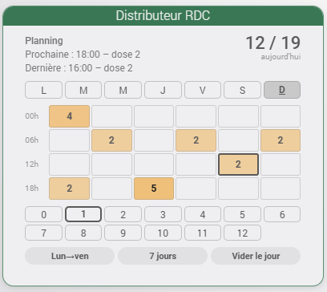

*Le planning du distributeur dans Jeedom (widget planningDistrib) : c'est ce planning que le bouton affiche sur son anneau.*

| Champ | Rôle |
| --- | --- |
| Nom affiché | nom sur l'écran (sans accent) ; vide avec un planning : nom de l'équipement planningDistrib |
| Planning (planningDistrib) | facultatif (firmware 3.2) : équipement du plugin **planningDistrib**. Le bouton affiche alors le planning du jour, et la distribution passe par ce plugin (elle est comptée dans « Distribué aujourd'hui »). Les doses mini / maxi et la couleur sont reprises du planning à chaque envoi de la configuration |
| Distribuer (curseur) | commande **action curseur** qui reçoit le nombre de doses et lance la distribution |
| Dose mini / maxi | plage de la molette (1 à 12 par défaut) |
| Connexion (info binaire) | facultatif : 1 = connecté. Si l'appareil est hors ligne, le bouton affiche « Hors ligne » et refuse de distribuer |

Sur le bouton : **tournez la molette** pour choisir le nombre de doses, puis **appuyez** (bouton ou tap sur l'écran) : « Distribuer 3 ? » s'affiche ; **appuyez une seconde fois dans les 3 secondes** pour distribuer (firmware 3.2 ; sinon la demande est annulée). « Distribue ! » confirme l'envoi. Avec plusieurs distributeurs, **glissez du doigt** pour passer de l'un à l'autre. Appui long ou icône retour : annule la confirmation ou le choix de la dose, puis retour à l'accueil.

Avec un planning planningDistrib, l'écran s'ouvre sur une **vue d'ensemble** : anneau des 24 heures du jour (dose de chaque heure, orange d'autant plus intense que la dose est forte, repère sur l'heure actuelle), doses distribuées / prévues aujourd'hui (avec planningDistrib 0.1.6 ou plus : doses du planning seulement, les distributions manuelles sont affichées à part, « +1 manuelle »), prochaine et dernière distribution. Tournez la molette ou appuyez pour choisir la dose ; sans action pendant 10 secondes, la vue d'ensemble revient.

Si vous modifiez les doses mini / maxi ou la couleur dans planningDistrib, **renvoyez la configuration** au bouton pour qu'il les reprenne. Le planning lui-même (doses heure par heure) se met à jour tout seul.

### 5.4 Page Planning du chauffage (facultatif)

Pour un thermostat dont les modes sont programmés par le plugin [planningThermo](https://github.com/JeromeR60/jeedom-planningThermo). Il faut le **firmware 3.1** ou plus.

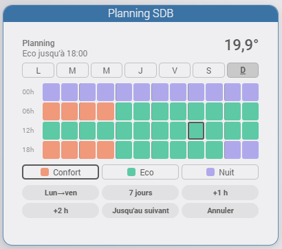

*Le planning du thermostat dans Jeedom (widget planningThermo) : le bouton reprend ses modes et ses couleurs.*

**Configuration** : dans la section **Chauffage**, choisissez l'équipement planningThermo dans le champ **Planning (page supplémentaire)**, sauvegardez, puis envoyez la configuration. Le bouton **Importer depuis un thermostat** le choisit pour vous si un seul planning pilote ce thermostat. Le plugin reprend tout seul les commandes du planning, l'info de verrouillage du thermostat et les modes avec leurs couleurs. Si vous modifiez les modes ou les couleurs dans planningThermo, renvoyez la configuration.

Sans planningThermo, ou avec le champ sur *Aucun*, l'écran Chauffage reste tel quel.

**Sur le bouton** : depuis l'écran Chauffage, **glissez vers la gauche** pour ouvrir la page Planning (deux points en bas indiquent la page) ; glissez vers la droite pour revenir au thermostat.

- L'**anneau** montre le planning du jour en 48 créneaux de 30 minutes, aux couleurs des modes, 00:00 en haut. Les créneaux passés sont estompés, un repère blanc marque l'heure actuelle et une dérogation en cours est soulignée.
- Au **centre** : l'état (*Planning*, *Dérogation* ou *Planning suspendu*), le mode en cours dans sa couleur, son heure de fin (« jusqu'à 23:00 ») et le mode suivant.

**Menu** : tournez la molette ou appuyez (ou tapez sur l'écran) :

| Choix | Effet |
| --- | --- |
| un mode (Confort, Eco, Nuit…) | ouvre le choix de la durée : jusqu'au prochain changement, 30 min, 1 h, 2 h ou 3 h ; l'anneau montre un aperçu, l'appui envoie la **dérogation** |
| Annuler dérog. | proposé pendant une dérogation : retour au planning |
| Suspendre / Reprendre | arrête ou relance l'envoi des ordres par le planning |

L'icône retour ou un glissement vers la droite reviennent à l'étape précédente ; l'appui long ferme le menu ; sans action, le menu se ferme au bout de 20 secondes.

Quand le thermostat est **verrouillé** (par exemple par un scénario vacances), la page affiche *Thermostat verrouillé – Vacances – Planning en pause* et ne propose aucune action.

Les icônes de mode de l'écran Chauffage envoient toujours le mode directement au thermostat : ce choix reste actif jusqu'au prochain changement du planning.

---

## 6. Mettre à jour le firmware des boutons

### 6.1 Rendre un firmware disponible dans Jeedom

Sur la page du plugin, section **Firmware des boutons** :

- **Récupérer la dernière version sur GitHub** (recommandé) : télécharge le `firmware.bin` de la dernière release publiée. Ces firmwares sont compilés **sans aucun mot de passe** ; chaque bouton garde ses propres réglages.
- ou, en **mode avancé** uniquement, **Déposer un firmware.bin** : envoie un fichier que vous avez compilé avec PlatformIO.

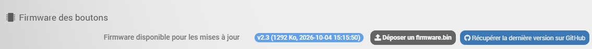

En mode avancé, le bouton **Déposer un firmware.bin** apparaît à côté :

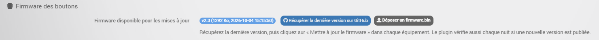

La ligne **Firmware disponible pour les mises à jour** affiche la version, la taille et la date du fichier présent dans Jeedom.

> Depuis la version 1.8, cette étape est facultative : **Mettre à jour le firmware** (§6.2) récupère elle-même la dernière version publiée si elle est plus récente.

### 6.2 Mettre à jour un bouton

Dans l'équipement, cliquez sur **Mettre à jour le firmware** (ou utilisez la commande action du même nom, par exemple dans un virtuel ou un scénario).

Depuis la version 1.8 du plugin, cette commande vérifie d'abord sur GitHub si une version plus récente que celle présente dans Jeedom est publiée, et la récupère automatiquement : un seul clic suffit après la notification d'une nouvelle version. Un firmware plus récent déposé à la main (mode avancé) est conservé. Si GitHub est injoignable, le firmware déjà présent dans Jeedom est envoyé.

Le bouton télécharge le firmware depuis Jeedom, l'installe puis redémarre (environ 30 secondes). La commande **État de la mise à jour** suit l'avancement (pourcentage, `ok, redemarrage` ou message d'erreur). En cas de coupure, le bouton fait jusqu'à 3 tentatives.

La version affichée sur la vignette change dès que le bouton est de retour en ligne.

### 6.3 Être prévenu des nouvelles versions

Chaque nuit, le plugin consulte la dernière version publiée. Si un bouton est en retard :

- un **message Jeedom** l'indique (une seule fois par version) ;
- la vignette affiche un badge **MAJ dispo** ;
- la commande **Mise à jour disponible** passe à 1 (pratique pour une notification par scénario).

Avec l'option **Installer automatiquement les nouvelles versions**, le plugin télécharge le firmware et met à jour lui-même les boutons en ligne.

### 6.4 Exemple : un bouton « Mettre à jour » sur votre dashboard

Pour garder la main sur le moment de la mise à jour tout en l'ayant à portée de clic, ajoutez un bouton dans un de vos virtuels, visible uniquement quand une nouvelle version existe.

**a. Dans votre virtuel**, ajoutez une commande **Action** (sous-type **Défaut**), par exemple « Mettre à jour M5Dial », et choisissez dans sa colonne **Paramètres** la commande `#[Objet][Votre bouton M5Dial][Mettre à jour le firmware]#`. Un clic suffit : le plugin récupère la dernière version sur GitHub puis l'envoie au bouton.

**b. Un scénario** affiche ce bouton seulement quand c'est utile :

- **Déclencheur** : `#[Objet][Votre bouton M5Dial][Mise à jour disponible]#`
- **SI** `triggerValue() == 1` **ALORS** une notification de votre choix (facultatif)
- puis, **en dehors du SI**, un bloc **Code** :

```php
$cmd = cmd::byString('#[Objet][Votre virtuel][Mettre à jour M5Dial]#');
$dispo = cmd::byString('#[Objet][Votre bouton M5Dial][Mise à jour disponible]#')->execCmd();
$cmd->setIsVisible($dispo == 1 ? 1 : 0);
$cmd->save();
$cmd->getEqLogic()->refreshWidget();
```

Remplacez les chemins par les vôtres (sélecteur de commandes). Le déclencheur ne réagit qu'à un **changement** : lancez le scénario une fois à la main pour masquer le bouton dès maintenant. Avec plusieurs boutons M5Dial, ajoutez un déclencheur et un bloc par bouton.

---

## 7. Topics MQTT (pour information)

| Topic | Sens | Contenu |
| --- | --- | --- |
| `m5dial/<nom>/status` | bouton → Jeedom | `online` / `offline` (retenu, message de dernière volonté) |
| `m5dial/<nom>/info` | bouton → Jeedom | JSON : nom, clientId, version, config, ip, mac, rssi, ssid, uptimeMin, memoireLibreKo, memoireMiniKo, plusGrosBlocKo (retenu, toutes les 5 min) |
| `m5dial/<nom>/config` | Jeedom → bouton | configuration JSON (retenu) ; message vide = configuration locale |
| `m5dial/<nom>/config/erreur` | bouton → Jeedom | erreur de configuration |
| `m5dial/<nom>/ota` | Jeedom → bouton | `{"url": ..., "version": ...}` : demande de mise à jour |
| `m5dial/<nom>/ota/etat` | bouton → Jeedom | avancement de la mise à jour |

---

## 8. Dépannage

| Symptôme | Que faire |
| --- | --- |
| Le bouton n'apparaît pas dans Jeedom | Vérifier que MQTT Manager est démarré, que le bouton est connecté au Wi-Fi et qu'il a été appairé. Avec MQTT Explorer, vérifier qu'il publie sur `m5dial/#`. |
| Aucune demande d'appairage | Vérifier l'adresse de Jeedom saisie dans le portail ; rouvrir le portail (bouton maintenu au démarrage) et cocher *Réappairer*. |
| Commandes lentes, déconnexions MQTT | Lancer un `ping -t` vers le bouton et vers Jeedom : si seul le bouton perd des paquets, le problème vient du Wi-Fi (Wi-Fi 6 sur 2,4 GHz, signal faible). |
| « La configuration est vide » | Sauvegarder l'équipement avant d'envoyer la configuration. |
| Mise à jour en échec | Vérifier que le bouton est en ligne et que Jeedom peut joindre GitHub (sinon déposer le firmware à la main, §6.1), puis relancer. Le détail est dans le log `m5dial`. |
| Le bouton répond « déjà à jour » | Il a déjà la version proposée : rien à faire. |
| Pas de page Planning, ou distributeur sans anneau | Vérifier le firmware (3.1 pour le chauffage, 3.2 pour les distributeurs), que le plugin de planning est installé et l'équipement **activé**, puis renvoyer la configuration. Un équipement de planning introuvable est signalé dans le log `m5dial`. |
| Page Planning sur « En attente », mode « ? », compteur « - / - » | Le bouton ne reçoit pas les infos du planning : vérifier dans MQTT Manager que les événements de **toutes** les commandes sont publiés (les infos des plugins de planning sont des commandes masquées) ; avec MQTT Explorer, vérifier `jeedom/cmd/event/<id>` pour ces commandes. |
| Surveiller la mémoire du bouton | Afficher sur un même graphique **Mémoire libre**, **Mémoire mini**, **Plus gros bloc libre** et **Durée de fonctionnement**. Des courbes plates entre deux redémarrages sont normales ; un pic de mémoire libre correspond en général à un redémarrage (la durée repart à 0). À surveiller : *Mémoire mini* qui baisse jour après jour, ou *Plus gros bloc libre* qui descend sous ~20 Ko. |
| Les accents s'affichent mal | Écrire les noms sans accents. |

---

## 9. Sécurité et données

**Ce que le plugin transmet et conserve**

- Le **mot de passe Wi-Fi** est saisi dans le portail du bouton et reste uniquement dans le bouton.
- Lors de l'appairage, Jeedom transmet au bouton l'**utilisateur et le mot de passe MQTT** (repris de MQTT Manager) et le **mot de passe des mises à jour**. Ils sont stockés dans la mémoire du bouton.
- Cette transmission se fait en **HTTP sur votre réseau local** (le bouton ne gère pas le HTTPS). Elle n'a lieu qu'une fois, après votre validation.
- Le plugin conserve pour chaque bouton : son nom, son adresse MAC, son adresse IP, son réseau Wi-Fi (SSID) et sa version. Aucune donnée n'est envoyée en dehors de votre réseau, à part la consultation de la dernière version publiée sur GitHub.

**Protections**

- Aucun mot de passe n'est contenu dans les firmwares publiés.
- L'appairage demande une **validation manuelle** dans Jeedom, avec vérification du code à 4 chiffres affiché sur le bouton. Les identifiants ne sont remis qu'au bouton qui a fait la demande (même adresse MAC, même code, même adresse IP).
- Les mises à jour du firmware utilisent un **jeton à usage limité** (15 minutes), créé à chaque demande. Le bouton n'accepte que les mises à jour venant de l'adresse de Jeedom qu'il connaît.
- Les pages de configuration du plugin sont réservées aux administrateurs Jeedom.

**Conseils**

- Placez les boutons sur un réseau Wi-Fi de confiance (idéalement un réseau dédié aux objets connectés).
- Utilisez un utilisateur MQTT dédié aux boutons.

---

Plugin indépendant, **non affilié à M5Stack**. M5Stack et M5Dial sont des marques de leurs propriétaires respectifs.
